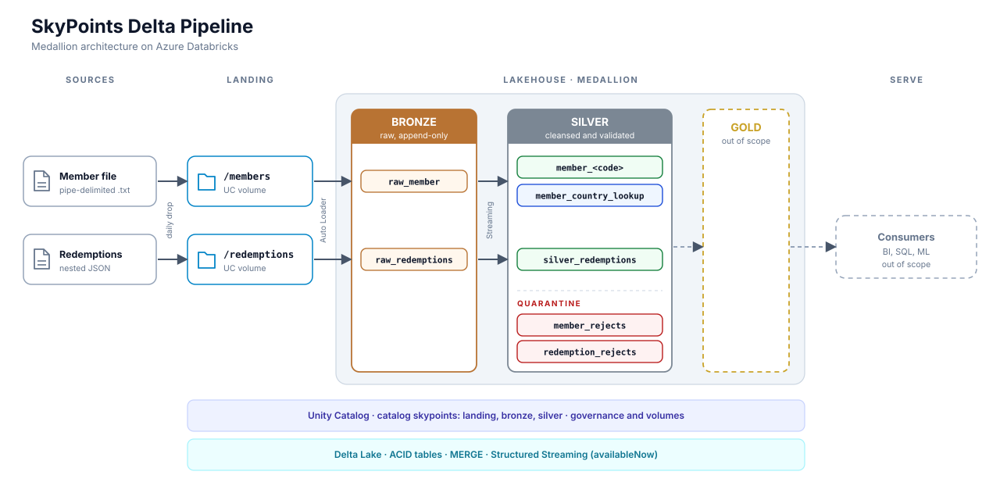

# SkyPoints Delta Pipeline

Incremental medallion pipeline on Databricks and Delta Lake for the SkyPoints loyalty program. It ingests two daily feeds, validates them, and publishes clean silver tables.

- **2 feeds:** member profile (pipe-delimited flat file) and partner redemptions (nested JSON)
- **3 layers:** landing, bronze, silver (gold is out of scope)
- **0 silent drops:** every failed row lands in a reject table with a reason code and the raw record
- **Idempotent writes:** any batch can be rerun and gives the same tables
- **Latest record wins:** driven by `file_date`, so late or old files cannot overwrite newer data



Full design, column rules and worked examples: [docs/DESIGN.md](docs/DESIGN.md).

## Tech stack

| Area | Tooling |
|---|---|
| Platform | Azure Databricks, Unity Catalog (catalog `skypoints`, schemas `landing`, `bronze`, `silver`) |
| Ingestion | Auto Loader (`cloudFiles`), explicit schemas, `_rescued_data` |
| Processing | PySpark, Structured Streaming (`availableNow` + `foreachBatch`) |
| Storage | Delta Lake, liquid clustering |
| Tests | pytest |

## Pipeline at a glance

| Stage | What happens | Tables |
|---|---|---|
| Landing | Source team drops one file per feed per day. Files are never modified. | `/Volumes/skypoints/landing/members`, `/Volumes/skypoints/landing/redemptions` |
| Bronze | Raw copy, every data column `STRING`, append-only, no rejection. | `bronze.raw_member`, `bronze.raw_redemptions` |
| Silver member | Trim, convert, validate, derive `age` and `stale_member`, keep latest record, split by country. | `silver.member_<code>`, `silver.member_country_lookup`, `silver.member_rejects`, `silver.country` |
| Silver redemption | Explode array, trim, convert, validate, keep latest per transaction, flag orphan members. | `silver.silver_redemptions`, `silver.redemption_rejects` |

**Run order:** members first, then redemptions. The orphan flag reads `member_country_lookup`, so members that arrive in the same cycle are found.

## Repository structure

```text
.
├── data
│   ├── country_reference.csv        # fixed country list, loaded into silver.country
│   ├── flat_files/                  # sample member files
│   └── json_feeds/                  # sample redemption files
├── docs
│   ├── DESIGN.md                    # full design and implementation notes
│   └── architecture.svg             # diagram used above
├── pipeline_utils
│   └── silver
│       ├── clean_and_validate_member.py       # trim, convert, validate, derive, latest record
│       ├── country_tables.py                  # country split, lookup, parallel merges, reconciliation
│       ├── process_member_batch.py            # per-micro-batch member job, reject writer
│       ├── clean_and_validate_redemptions.py  # explode, trim, convert, validate, latest record, orphan flag
│       └── process_redemptions_batch.py       # per-micro-batch redemption job, reject writer, MERGE
├── src
│   ├── init
│   │   ├── initial_setup.ipynb                # catalog, schemas, volumes
│   │   └── setup_country_table.ipynb          # loads data/country_reference.csv
│   ├── bronze
│   │   ├── bronze_create_member.ipynb
│   │   └── bronze_create_redemptions.ipynb
│   └── silver
│       ├── silver_create_member.ipynb
│       └── silver_create_redemptions.ipynb
├── test
│   ├── conftest.py
│   ├── helpers.py
│   ├── test_country_tables_pure.py
│   ├── test_delta_integration.py
│   ├── test_members_clean_validate.py
│   ├── test_process_batches.py
│   └── test_redemptions_clean_validate.py
├── pytest.ini
├── requirements-test.txt
├── LICENSE
└── README.md
```

Notebooks hold only DDL, configuration and the stream start. All logic lives in `pipeline_utils`, so it can be imported and unit tested without a cluster.

## Key design decisions

| Decision | Choice | Reason |
|---|---|---|
| Bronze types | All data columns `STRING` | Keeps values like `000224160` and `03051985` intact |
| Failed rows | Reject table per feed, `column:CHECK` codes joined with `; ` | Nothing is lost, rejects can be replayed |
| Latest wins (member) | `file_date`, `ingestion_timestamp`, `last_flight_date`, then remaining columns | Same result on every run, even on full ties |
| Latest wins (redemption) | Same order, key is `(member_id, txn_id)`, SCD1 MERGE | A stale file cannot revert `COMPLETED` to `PENDING` |
| Derived columns | Use `file_date`, never `current_date()` | Deterministic reruns |
| Country move | Upsert into new table, delete from old, update `member_country_lookup` last | Delta has no multi-table transactions. A crash leaves the lookup at the old value, so the retry finds the same movers. |
| Late member | Redemption is kept and flagged `is_member_id_orphan` | The feeds arrive independently, so a missing member is not a reject |
| Reject writes | `txnAppId` + `txnVersion = batch_id` | Delta skips a batch it already wrote, so reruns add no duplicate rejects |
| Country merges | One MERGE per country, thread pool up to `MAX_PARALLEL_MERGES` (8), largest country first | Fixed cost per MERGE, so small countries gain most from running together |

## Validation rules

| Rule | Member feed | Redemption feed |
|---|---|---|
| Mandatory value | `member_name`, `member_id`, `country_code`, `enrollment_date`, audit columns | `member_id`, `txn_id`, `txn_date`, `feed_date`, `partner`, `miles_redeemed`, `status`, audit columns |
| Max length | Per column (for example `member_id` 18, `tier_code` 5) | `member_id` 18, `txn_id` 100, `partner` 255, `status` 50 |
| Type conversion | Dates, `post_code` | Dates, `miles_redeemed` |
| Format | Letters/spaces or digits only | `member_id` digits, `txn_id` `[A-Za-z0-9_-]` |
| Allowed values | `tier_code`: `GLD`, `PLT`, `SLV` | `status`: `PENDING`, `COMPLETED`, `REJECTED` |
| Reference data | `country_code` must exist in `silver.country` | n/a |
| Range | Date year between 1900 and current year | Same, plus `miles_redeemed >= 0` |

Reject codes: `MISSING`, `TOO_LONG`, `INVALID_DATE`, `INVALID_INT`, `INVALID_FORMAT`, `INVALID_VALUE`, `NOT_IN_REFERENCE`, `NEGATIVE_VALUE`.

The date parser accepts exactly 8 digits and tries `ddMMyyyy`, `yyyyMMdd`, `MMddyyyy` in that order.

## Getting started

### Prerequisites

- Azure Databricks workspace with Unity Catalog enabled
- Permission to create a catalog, schemas and volumes
- This repo cloned as a Databricks Git folder, so `pipeline_utils` can be imported from the notebooks

### Setup

1. Run `src/init/initial_setup.ipynb` to create the `skypoints` catalog, the `landing`, `bronze`, `silver` schemas and the volumes.
2. Run `src/init/setup_country_table.ipynb` to load `data/country_reference.csv` into `skypoints.silver.country`.
3. Upload the sample files:
   - `data/flat_files/*` to `/Volumes/skypoints/landing/members`
   - `data/json_feeds/*` to `/Volumes/skypoints/landing/redemptions`

### Run

Run in this order. Each notebook processes everything new, then stops.

| # | Notebook | Result |
|---|---|---|
| 1 | `src/bronze/bronze_create_member.ipynb` | `bronze.raw_member` |
| 2 | `src/bronze/bronze_create_redemptions.ipynb` | `bronze.raw_redemptions` |
| 3 | `src/silver/silver_create_member.ipynb` | country tables, lookup, `member_rejects` |
| 4 | `src/silver/silver_create_redemptions.ipynb` | `silver_redemptions`, `redemption_rejects` |

## Operations

- **Rerun after a failure:** run the same notebook again. The checkpoint did not advance, so the batch is re-read and every write repeats safely.
- **Late files:** processed normally. The `file_date` guard in each MERGE stops them from overwriting newer rows.
- **Corrected files:** a file re-delivered under the same name is not loaded again. Send corrections under a new file name.
- **Full silver replay:** clear the silver checkpoint, truncate the silver targets, drop and recreate the reject table, then rerun. The reject table must be recreated because its `txnVersion` marker survives in the Delta log while batch ids restart at 0.
- **Full bronze replay:** clear the bronze table and checkpoint, rerun the bronze notebook, then replay silver. Landing is never touched.

Details: [docs/DESIGN.md](docs/DESIGN.md), section 11.2.

## Data-quality checks

Run after each cycle.

```sql
-- reject mix per feed, a new reason means a new failure type
SELECT reject_reason, COUNT(*) FROM skypoints.silver.member_rejects     GROUP BY 1 ORDER BY 2 DESC;
SELECT reject_reason, COUNT(*) FROM skypoints.silver.redemption_rejects GROUP BY 1 ORDER BY 2 DESC;

-- duplicate redemption keys, expect no rows
SELECT member_id, txn_id, COUNT(*)
FROM skypoints.silver.silver_redemptions GROUP BY 1, 2 HAVING COUNT(*) > 1;

-- orphan share per day, expect small and stable
SELECT file_date, COUNT(*) AS txns, SUM(CASE WHEN is_member_id_orphan THEN 1 ELSE 0 END) AS orphans
FROM skypoints.silver.silver_redemptions GROUP BY 1 ORDER BY 1;
```

Lookup against country tables, expect `difference = 0` for every country:

```python
from pipeline_utils.silver.country_tables import reconcile_lookup_with_country_tables
reconcile_lookup_with_country_tables(spark).display()
```

Each batch also prints a count line (`in = rejected + superseded + skipped + applied` for members, `in = rejected + superseded + upserted` for redemptions).

## Joining redemptions to members

Redemptions carry `member_id` and no name, so the link is `member_country_lookup`. The join is done at read time, not in silver, because the feeds arrive independently and a member's country can change after the redemption was written.

```sql
SELECT r.*, l.member_name, l.country_code
FROM skypoints.silver.silver_redemptions r
LEFT JOIN skypoints.silver.member_country_lookup l
  ON r.member_id = l.member_id;
```

`is_member_id_orphan` is a load-time snapshot for monitoring. Use the join above for a current answer.

## Testing

```bash
pip install -r requirements-test.txt
pytest
```

| File | Covers |
|---|---|
| `test_members_clean_validate.py` | Member trim, convert, validate, latest record |
| `test_redemptions_clean_validate.py` | Redemption explode, validate, latest record, orphan flag |
| `test_country_tables_pure.py` | Country-table helpers that need no Spark session |
| `test_process_batches.py` | Per-micro-batch jobs |
| `test_delta_integration.py` | Delta MERGE behavior |

## Known limitations

- **Ambiguous dates:** a value valid in two formats (for example `03051985`) is read as `ddMMyyyy`. The upper year bound uses `current_date()`, so it is the one run-date dependency.
- **Strict name format:** `member_name`, `agent_name` and `state` accept ASCII letters and spaces only. Accents, hyphens and non-Latin scripts are rejected as `INVALID_FORMAT`.
- **Separate country tables:** a country move touches two tables and is not atomic. At billions of rows, one `members` table clustered by `(country_code, member_name)` with a view per country would avoid this. Separate tables fit when residency, retention or consumer isolation differ per country. See [docs/DESIGN.md](docs/DESIGN.md), section 12.
- **Not built:** gold layer, status history for redemptions, `fee_usd` / `channel` / `route` columns (they stay in `_rescued_data`).

## License

See [LICENSE](LICENSE).